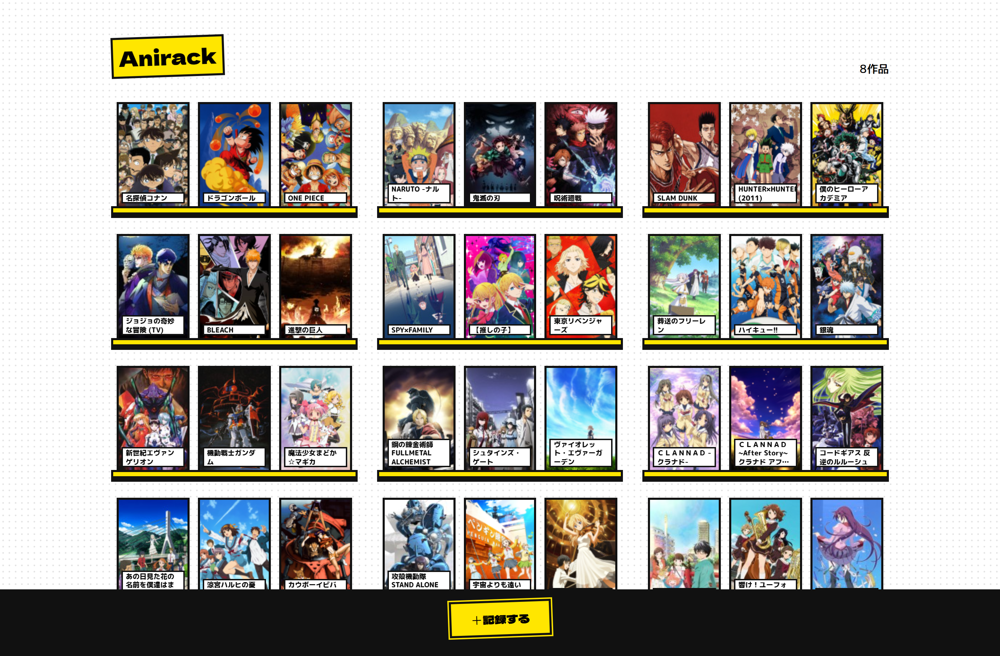

# Anirack

アニメ・漫画の視聴記録と感想を、自分用にまとめられる Web アプリです。

**サービス URL:** https://kensaku-ikeda.github.io/Anirack-JS/

## 想定ユーザー

- アニメ・漫画を多く視聴している人
- SNS に感想を投稿するハードルはあるものの、自分用には記録を残したい人

## 使用技術

- HTML / CSS / JavaScript（フレームワークなし）
- localStorage（データ保存）
- AniList API（作品データ・画像の取得）

## 開発目的

React に進む前に、以下の JavaScript の基礎を実践的に身につけることを目的に開発しました。

- DOM 操作
- イベント処理
- localStorage を利用したデータ保存
- API 連携

すべてのコードを自ら実装し、面接で自分の言葉で説明できる成果物を目指しています。

## 開発背景

アニメが好きで、視聴した作品の記録や感想をまとめることを楽しんでいました。しかし、SNS へ感想を発信すると、意図せず否定的な反応を受けることもあります。

そこで、他者の反応を気にせず、自分のために作品の記録や感想を残せるアプリとして、本アプリを開発しました。

## 工夫した点

### 開発の進め方

- 機能ごとに GitHub Issue を作成し、ブランチを分けて開発しています。
- チーム開発を意識し、すべての変更を Pull Request 経由でマージしています。
- `main` ブランチを保護し、目的・理由・確認内容を PR テンプレートに記録しています。
- Conventional Commits 形式にコミットメッセージを統一し、commitlint と husky で自動チェックしています。
- ESLint を使用してコードの品質をチェックしています。
- 要件定義書やタスクごとの実装方針を `docs` フォルダに記録しています。

### AI の活用

- Claude をメンターとして活用し、ヒントを参考にしながらコードは自分で実装しています。
- ブランチ作成やコミットなど、Git の定型作業は Claude に任せています。
- コミット前には変更内容とメッセージを確認・承認する運用とし、利用ルールを `.claude/rules` に記載しています。
